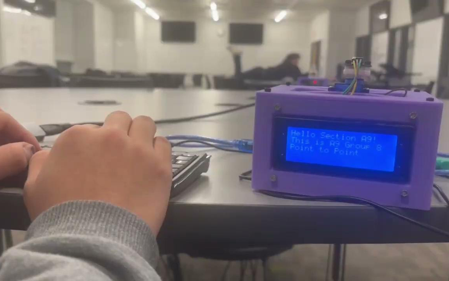

# Gabriel Mukherjee

Boston University mechanical engineering student working on CAD and technical drawings, hardware integration and prototyping, and experimental analysis.

**B.S. Mechanical Engineering · Expected May 2028 · Chemistry minor in progress**

**Seeking Summer 2027 engineering internships.** Interests: robotics, manufacturing and automation.

[LinkedIn](https://www.linkedin.com/in/gabriel-mukherjee/) · [Email](mailto:gabemuk@bu.edu) · [Software source](https://github.com/gabemuk/will-i-gap-it)

EK210 team prototype: Ken Yasuda, Gabe Mukherjee, Jake Spaulding and Matthew Watkins. Printed parts credited to Jake Spaulding in the team BOM.

## Selected engineering work

| Project | Work and result | Evidence |
| --- | --- | --- |
| **1. Optical Communication System** | Contributed CAD, hardware integration and testing to a four-person EK210 infrared messaging prototype. Team-reported transmission through 13 ft against a 5 ft requirement. | [Prototype and team CAD](projects/optical-communication.md) |
| **2. Arduino Temperature Monitor and Alert Device** | Integrated an Arduino-based temperature display with LED/buzzer threshold alerts in a custom enclosure. It does not regulate temperature or control heating/cooling equipment. | [Open/closed build and enclosure CAD](projects/temperature-monitor-alert-device.md) |
| **3. Mechanical CAD and Technical Drawings** | SolidWorks cap coursework with section and detail views in millimetres. Educational documentation; fabrication and fit are unverified. | [Native model and original drawing](projects/mechanical-cad-drawings.md) |
| **4. Thermal Model and Boiling Experiment** | Team laboratory records compared with an approximate model. Inferred latent heats fall below the reference; the case examines assumptions and uncertainty. | [Measured traces and model comparison](projects/thermal-model-experiment.md) |
| **5. Will I Gap It?** | Maintainer of a Next.js/TypeScript vehicle-comparison project with shared and AI-assisted contributions. Heuristic estimates and user-reported results; not a calibrated performance simulator. | [Source and engineering notes](https://github.com/gabemuk/will-i-gap-it) · [Live app](https://willigapit.com) |

Will I Gap It? is supporting software work. Local v2 correctness fixes and Supabase security work must not be assumed deployed on the linked live app.

## Supporting work

- [Real estate analytics platform](projects/parcel-analytics.md) — private team prototype using PostgreSQL and municipal data; sanitized overview only.
- [Catalyst-dependent Biginelli synthesis](projects/chemistry-capstone.md) — team chemistry coursework with an individually documented catalyst condition.

## Technical focus

- **CAD and documentation:** SolidWorks coursework, dimensioned drawings, section and detail views.
- **Hardware:** Arduino, enclosure packaging, electronics integration, assembly and prototype troubleshooting.
- **Analysis:** measured temperature records, energy-balance assumptions and uncertainty interpretation.
- **Supporting software:** Next.js, React, TypeScript and Supabase/PostgreSQL project context, with shared and AI-assisted contributions.
