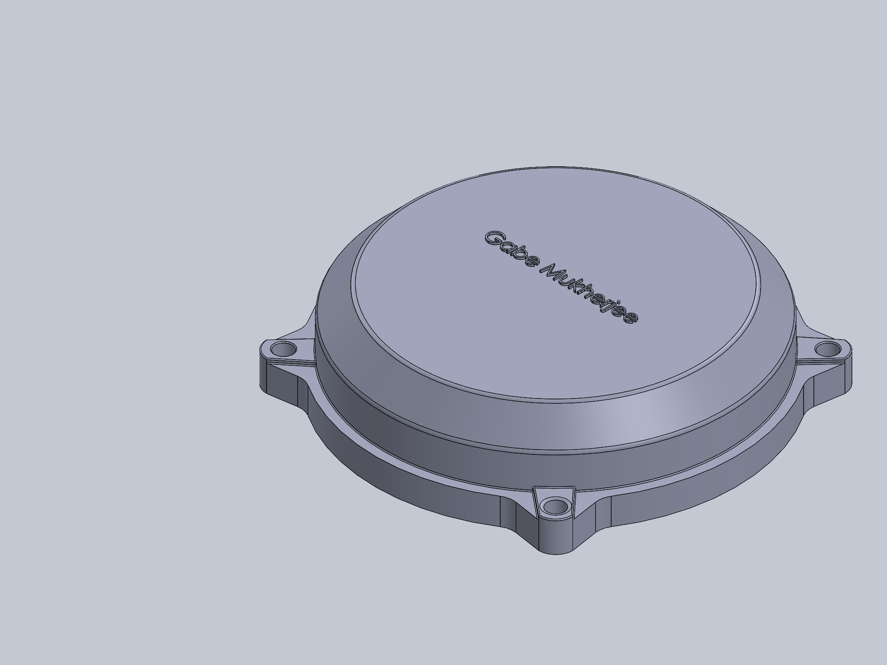
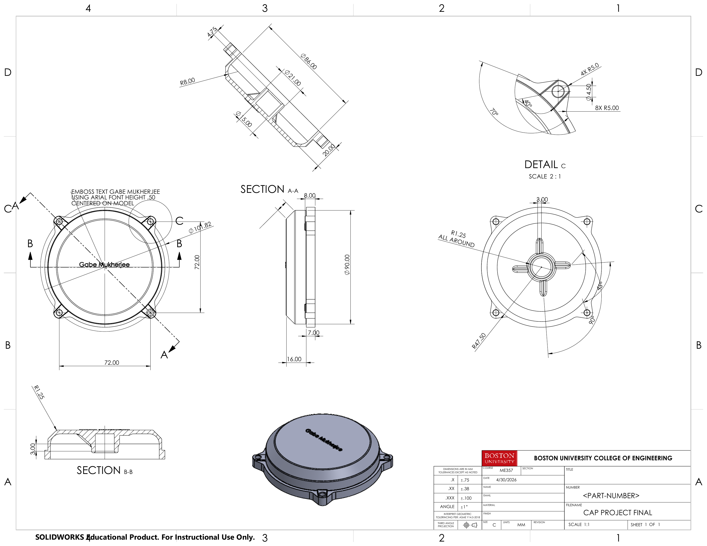

# Mechanical CAD and Technical Drawings

**Context:** Boston University ME357 SolidWorks coursework sample attributed to Gabriel Mukherjee. The original drawing is dated 30 April 2026; this is a drawing date, not a verified fabrication or project-completion date.

## Objective and contribution

Document a cap coursework part with a native model view and dimensioned engineering drawing. The sample supports CAD/drawing work attributed to Gabriel; the course brief and supplied-versus-authored geometry have not been recovered, so original geometry invention and individual feature ownership are unresolved.

## Documentation constraint and approach

An exterior isometric view cannot fully show internal geometry. The original drawing adds section and enlarged detail views, retaining dimensions in **millimetres** and the educational-use notice. Open the full-sheet image for its native resolution; screen display is not a printed scale reference.

## Native model and drawing evidence

Genuine isometric export from the original cap part, opened read-only and rebuilt in memory in SolidWorks 2025 SP5.0. No fabrication or fit validation claimed.

*Credit: Gabriel Mukherjee coursework sample, BU ME357; educational CAD export, not a claim of original geometry invention.*

Original cap drawing in millimetres, including sections and detail view. Coursework documentation with incomplete title-block fields; not a released manufacturing drawing.

*Credit: Gabriel Mukherjee coursework sample, BU ME357. Course-supplied design brief not recovered; educational-use notice retained.*

## Result and limits

The native cap opened read-only and rebuilt in memory during the earlier evidence review in SolidWorks 2025 SP5.0. The figure is the genuine approved export from that review; this stage did not reopen or rebuild the CAD.

As a limited drawing-consistency check, a 72 mm square hole pattern has a diagonal of `72 × √2 = 101.823 mm`, consistent with the 101.82 mm callout. This does not constitute a complete dimension or tolerance-stack review.

The result is educational CAD documentation. Incomplete title-block fields and the original placeholder part number remain intact. Material/process selection, fabrication, functional fit, inspection, manufacturability and production release are not established. The sheet alone does not demonstrate GD&T proficiency.

**Evidence basis:** Approved native-part isometric export and full original cap drawing. Educational markings are preserved; no manufactured component or new validation is claimed.

[Engineering index](../README.md) · [Figure inventory and credits](../assets/README.md)
