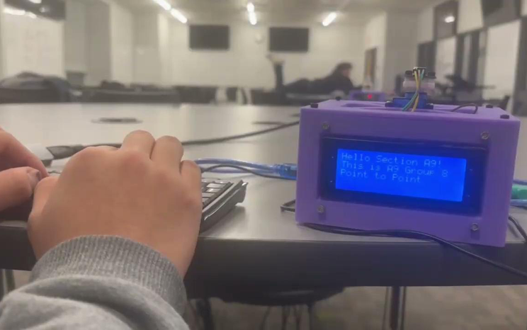
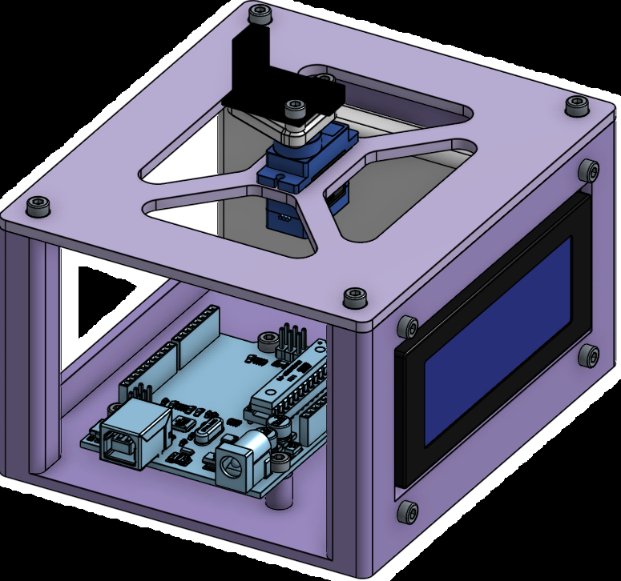
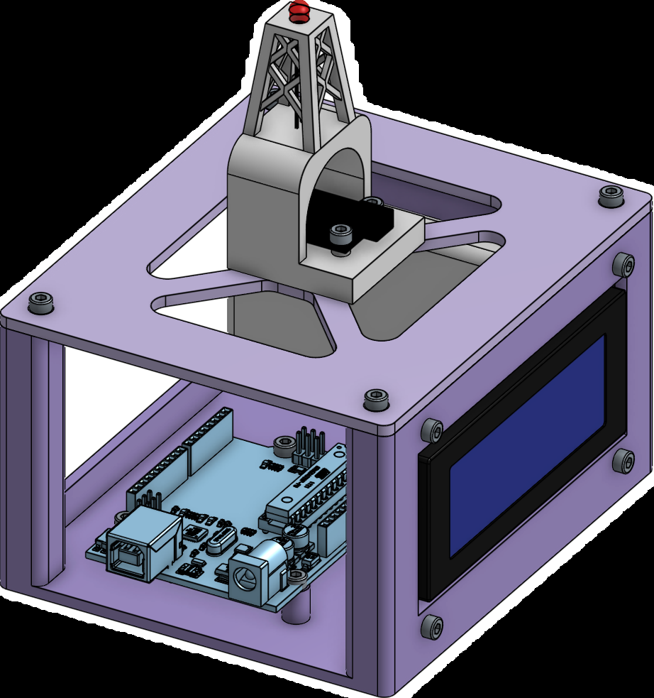

# Optical Communication System

**Context:** Four-person Boston University EK210 Section A9 team prototype, Fall 2025.

## Objective and system

Transmit keyboard-entered text over a directional optical link with a 5 ft minimum distance requirement. The team built two self-contained units connecting PS/2 keyboard input, Arduino microcontrollers, modulated infrared communication and 20 × 4 LCD output, with servo aiming and printed enclosures. The 38 kHz value is modulation frequency, not data throughput.

## Contribution and team decision

I contributed to CAD, hardware integration and testing (owner-reported participation). Specific individual subsystem-design decisions remain unresolved. The four-person team comprised Ken Yasuda, Gabe Mukherjee, Jake Spaulding and Matthew Watkins; the team BOM credits printed-part manufacture to Jake Spaulding.

The team packaging places the optical mount above the enclosure lid and electronics below, organizing the signal path, display access and optical aiming. The CAD views document that arrangement, including vendor components. These are team choices rather than evidence of my sole design or fabrication ownership.

## Prototype and CAD evidence

Team optical-communication prototype with keyboard input and illuminated LCD.

*Credit: EK210 team: Ken Yasuda, Gabe Mukherjee, Jake Spaulding and Matthew Watkins. Printed parts credited to Jake Spaulding in the team BOM.*

Team transmitter assembly view showing the enclosure, electronics and optical mount, including vendor components.

*Credit: EK210 team: Ken Yasuda, Gabe Mukherjee, Jake Spaulding and Matthew Watkins. Printed parts credited to Jake Spaulding in the team BOM.*

Team receiver assembly view showing the enclosure, electronics and optical mount, including vendor components.

*Credit: EK210 team: Ken Yasuda, Gabe Mukherjee, Jake Spaulding and Matthew Watkins. Printed parts credited to Jake Spaulding in the team BOM.*

## Reported result and limits

The team report records successful transmission through **13 ft** against the **5 ft** requirement and a historical estimated component BOM of **$132.36** ($86.51 transmitter + $45.85 receiver). These are team-reported results, not guaranteed range, current procurement prices or independently verified reliability.

Raw trial counts and a complete repeatable range-test protocol are unavailable. Alignment and ambient-light conditions are not fully recorded. No error rate, throughput or measured system-power result is established. Listed power budgets in the report are selected-component estimates with unverified/excluded loads and losses, not simultaneous system measurements.

**Evidence basis:** EK210 team final report and presentation, represented here by approved authentic derivatives. No new hardware tests or native CAD rebuild were performed for this page.

[Engineering index](../README.md) · [Figure inventory and credits](../assets/README.md)
