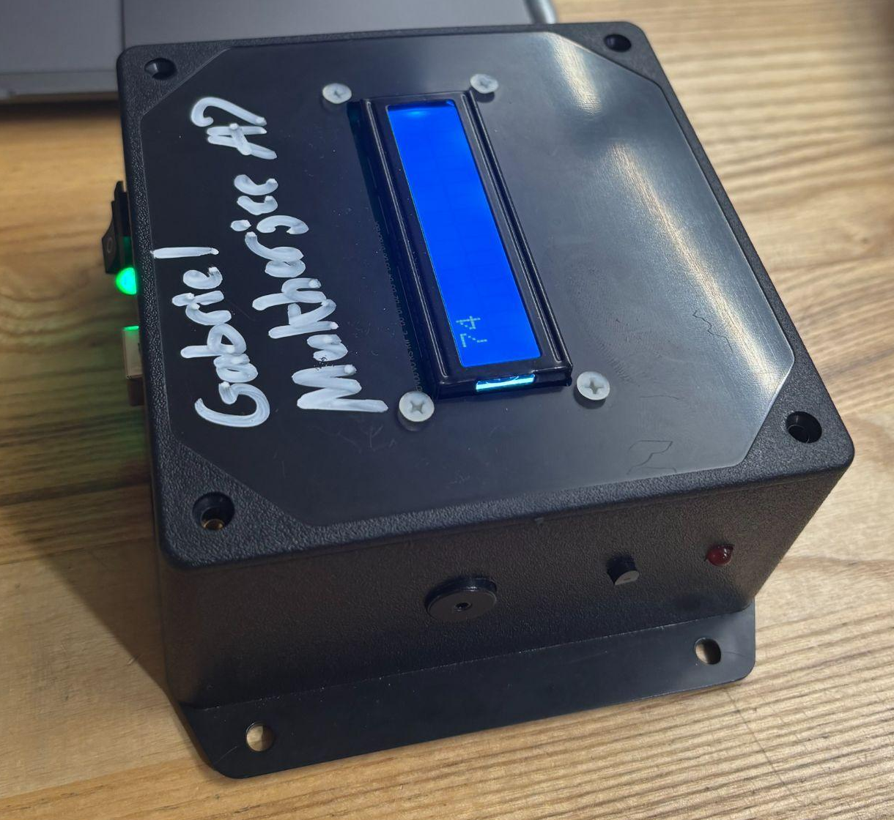
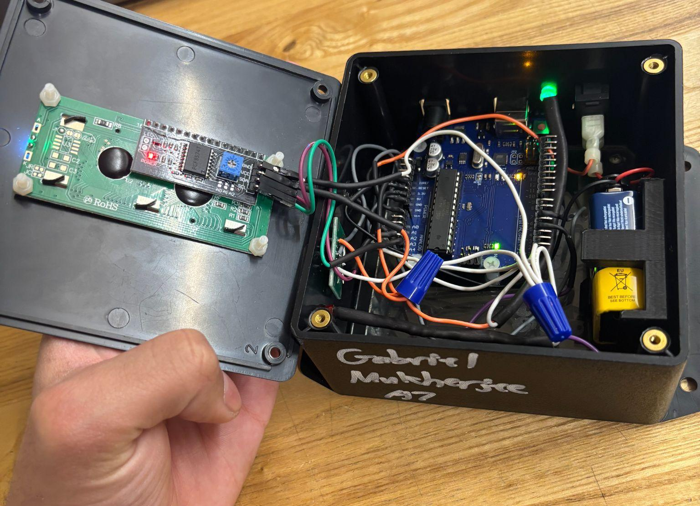
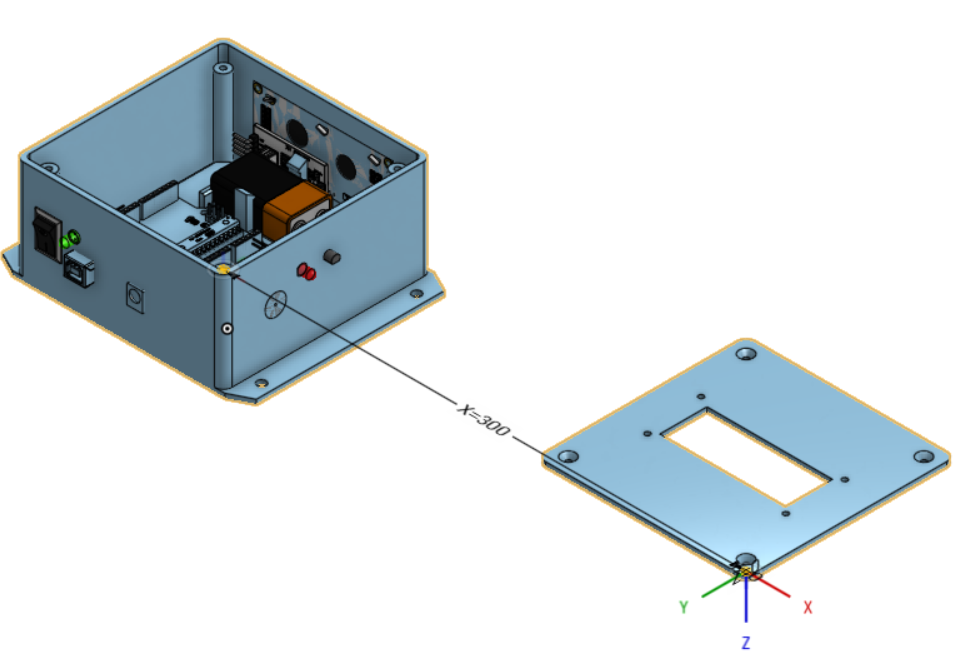

# Arduino Temperature Monitor and Alert Device

**Context:** Personal Boston University EK131 coursework prototype (existing Spring 2025 project label).

## Objective and contribution

Read temperature, display it locally and signal excursions outside the documented band with visual and audible alerts. I integrated and assembled the documented coursework build using an Arduino, sensor, LCD, switches, LED/buzzer indicators, wiring and a CAD-designed enclosure. Vendor/course components are distinguished from my enclosure and integration work; the enclosure used printed and laser-cut parts without establishing that I personally manufactured every component.

## Packaging and threshold logic

The controller, battery and wiring occupy the base, while the LCD attaches to the removable lid. This packaging exposes the display during use and provides access to the electronics when opened. The open/closed photographs show the resulting assembly; the exploded CAD illustration documents the intended separation of lid and base.

The report code reads A0 using a nominal 5 V ADC reference/conversion, stores Fahrenheit as an integer and triggers alerts for `TempF < 70 || TempF > 75`. It monitors temperature; **it does not regulate temperature or control heating/cooling equipment**. When alerting, the loop contains 2.7 s of programmed delays: 0.5 s before the condition and 2.2 s inside the alert branch. This is a code-path observation, not a measured system response time.

## Build and enclosure evidence

Closed, powered temperature monitor with externally accessible display and visual/audible indicators.

*Credit: Gabriel Mukherjee, EK131 coursework; Arduino, sensor, display and other vendor/course components distinguished from the enclosure work.*

Open build showing the controller, battery and wiring in the base, with the LCD attached to the removable lid.

*Credit: Gabriel Mukherjee, EK131 coursework; Arduino, sensor, display and other vendor/course components distinguished from the enclosure work.*

Original report CAD illustration of the open enclosure and separated lid. Native enclosure files and build-to-model correspondence are not independently verified.

*Credit: Gabriel Mukherjee, EK131 coursework; Arduino, sensor, display and other vendor/course components distinguished from the enclosure work.*

## Result and limits

The documented build combines temperature sensing, display and visual/audible alerts in an accessible enclosure. A lit display and physical assembly establish a build, not calibrated accuracy or endurance.

Installed firmware equivalence, calibrated accuracy, response time, battery life and long-duration reliability have not been verified. Report thresholds are not a calibrated performance specification. Native enclosure files and build-to-model correspondence are unverified; firmware, native CAD and a reproducible BOM are not published here.

**Evidence basis:** EK131 report code, authentic build photographs and original report CAD illustration. No new firmware, calibration or endurance tests were performed for this page.

[Engineering index](../README.md) · [Figure inventory and credits](../assets/README.md)
