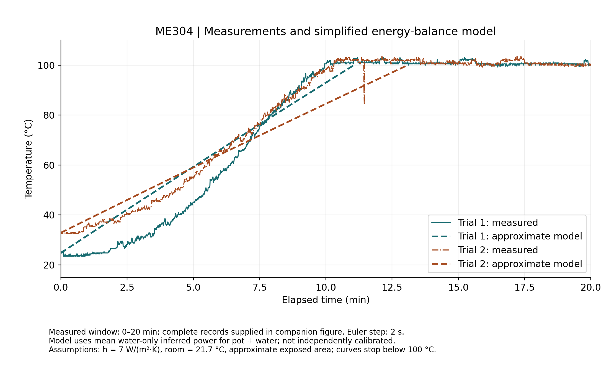
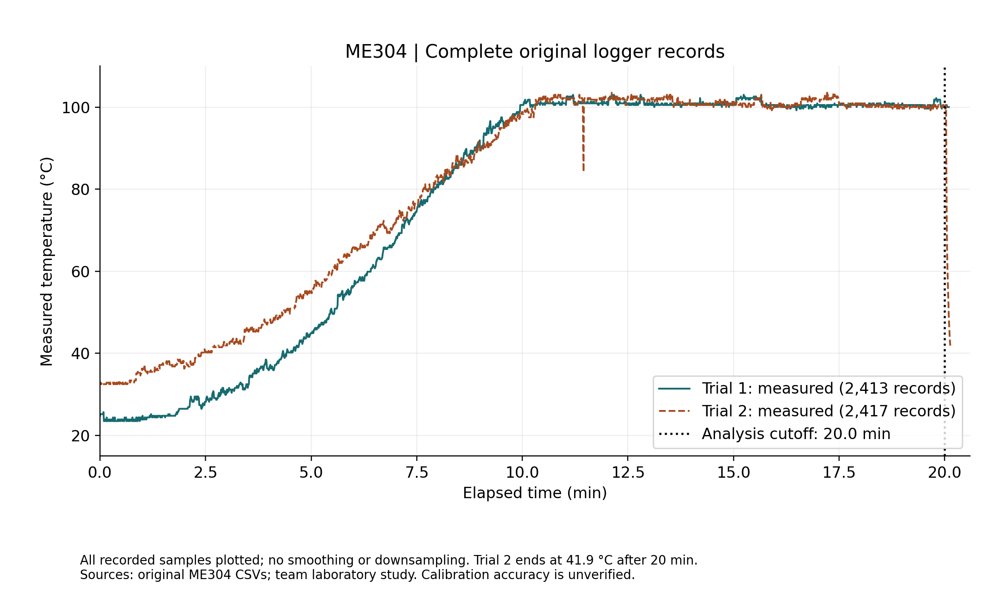
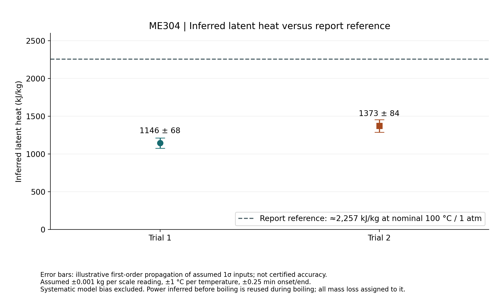

# Thermal Model and Boiling Experiment

**Context:** Boston University ME304 team laboratory study. Fall 2026 is the draft report's course term; the experiment date is unresolved.

## Objective and analytical constraint

Compare measured heating and boiling traces with a simplified pot-and-water energy balance, then examine why inferred latent heat differs from the report reference. Electrical heater power was not independently measured. The documented analysis instead infers average preboiling water-heating power and reuses it during boiling, assigning total mass loss to that interval.

## Measured records and model



Measured temperatures versus the simplified pot-plus-water model over 0–20 min. Model input power is inferred from water heating, not independently measured.

*Credit: ME304 team laboratory study; Stage 2A replot and calculation from original measurements.*



Complete measured logger traces in minutes and °C, including Trial 2’s drop after the 20 min analysis endpoint. Probe handling is unknown.

*Credit: ME304 team laboratory study; Stage 2A replot and calculation from original measurements.*


Trial 1 contains 2,413 logger records and Trial 2 contains 2,417, with time in minutes and temperature in °C. Their final timestamps are 20.100 and 20.133 min. Analysis ends at 20 min. Trial 2's full trace subsequently drops to 41.9 °C; probe handling is unknown, so this is not established as bulk-water cooling.

## Contribution and analysis provenance

Gabriel's supported role is team laboratory participation; individual measurement/analysis responsibilities and the final roster remain unresolved. Figures include later Stage 2A replot/calculation from original measurements. That later work is not presented as Gabriel's individually authored original analysis.

## Method and result

Using water heat capacity `c = 4,180 J/(kg·K)`, onset time `t_b` and a 20 min endpoint:

```text
P [W] = m_water × c × (100 − T_initial) / (60 × t_b)
L [kJ/kg] = P × 60 × (20 − t_b) / m_loss / 1000
```

The factors of 60 convert minutes to seconds; dividing joules by 1,000 gives kilojoules. Masses and mass losses are positive, with mass loss below initial water mass in each trial.

| Quantity | Trial 1 | Trial 2 |
| --- | ---: | ---: |
| Initial water mass (kg) | 0.543 | 0.741 |
| Logger initial temperature (°C) | 24.8 | 32.9 |
| Mass loss (kg) | 0.149 | 0.137 |
| Boiling onset used (min) | 10.0 | 10.5 |
| Inferred water-only heating rate (W) | 284.47 ± 8.93 | 329.90 ± 10.51 |
| Inferred latent heat (kJ/kg) | 1,145.53 ± 68.26 | 1,372.56 ± 83.94 |
| Difference from 2,257 kJ/kg reference | −49.25% | −39.19% |

The ± values are illustrative first-order standard uncertainties from assumed independent 1σ inputs: 0.001 kg per mass reading, 1 °C per temperature reading and 0.25 min for onset/end times. Propagation retains shared initial-mass/onset dependencies. These are not instrument-certified uncertainties, 95% confidence intervals or total-error bounds; systematic bias is excluded.



Inferred latent heats versus the report reference near 100 °C / 1 atm. Error bars propagate assumed inputs and exclude systematic bias.

*Credit: ME304 team laboratory study; Stage 2A replot and calculation from original measurements.*


## Interpretation and limitations

The reference is approximately 2,257 kJ/kg near 100 °C and 1 atm. The large mismatch remains despite the illustrative uncertainty; this analysis does not validate a latent-heat measurement or establish calibrated model accuracy.

The approximate pot-plus-water model uses mean inferred power **307.184816 W**, forward Euler steps of **2 s**, convection coefficient **7 W/(m²·K)** and ambient temperature **21.7 °C**. Reusing a water-only inferred input in that model does not establish actual electrical input or independently measured heat transfer. Pot/plate heat storage, changing losses, radiation, temperature gradients, exposed area and preboiling evaporation remain unresolved.

**Evidence basis:** Original team logger/mass records represented by approved public plots and later calculations. No new experiment or instrument calibration was performed. Original reports and raw evidence records are not distributed here.

[Engineering index](../README.md) · [Figure inventory and credits](../assets/README.md)
